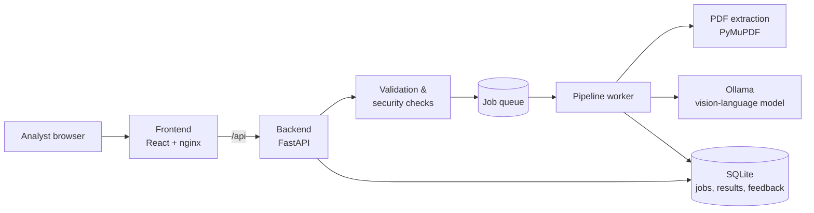

# HTX Document Analyst

<!-- TODO: replace with your CI badge once the workflow exists -->


<!-- TODO: one-sentence pitch. Example: "A fully local web app that helps Home Team analysts understand multiple incident reports at once: per-document key details, visual evidence analysis, and a consolidated cross-document report." -->
Fully local web application built to help Home Team investigators with multiple ticket/report analysis with included triage function to determine severity and importance of the document.

<!-- TODO: hero GIF of the full flow (upload → progress → results) -->

https://github.com/user-attachments/assets/792b719c-f43f-4b96-a751-06e53b10fb31


https://github.com/user-attachments/assets/ef2c2da5-0e83-48b9-9dcc-054648429ecf

https://github.com/user-attachments/assets/2cdf83fb-4091-4e73-ac4d-ecca619c6e85
## Contents

1. [Solution overview](#1-solution-overview)
2. [Architecture](#2-architecture)
3. [Setup instructions](#3-setup-instructions)
4. [Screenshots](#4-screenshots)
5. [Sample documents](#5-sample-documents)
6. [Output structure](#6-output-structure)
7. [Error handling and security](#7-error-handling-and-security)
8. [Optional AI feature: Triage](#8-optional-ai-feature-triage)
9. [Assumptions](#9-assumptions)
10. [Known limitations](#10-known-limitations)
11. [Use of AI-assisted tools](#11-use-of-ai-assisted-tools)
12. [Future work](#12-future-work)

---

## 1. Solution overview

### The problem
<!-- TODO: describe the analyst scenario in your own words. Who is the user, what do they receive, what slows them down today? -->
Is there a way to assist analysts in ticket and report handling understanndiong the current contect + increasing efficiency with the use of local ai due to the secrecy of information handled?

### What the app does
<!-- TODO: short paragraph on the flow. Upload one or more PDFs → each is validated, extracted page by page, images analysed by a local vision model → per-document key details → consolidated report across documents. -->
Wtih this web application we can upload multiple tickets/documents to be validated and extracted page by page + images are read by a local vision model to give a clear overall analysis of the document highlighting key details within the document to categorise what the report is about. 

### Analysis profiles
| Profile | Best for | Adds to the core output |
|---|---|---|
| General | Any document (news, reports) | summary of given report  |
| Incident | Incident tickets / reports with photos | Claims, narrative-vs-photo consistency checks, parties by role, missing information |
| Statistical | Statistics releases, data-heavy reports | Key figures, trends, reporting period |
<!-- TODO: remove rows for profiles you didn't build -->

### Key design principles
<!-- TODO: explain each in a sentence or two, in your words -->
- **Fully local inference**: Using a local model to first infer as best as it can regarding the document. picking out key words that shows what kind of report/ticket this is
- **Analyst in the loop**: I gave it an analyst persona as thats the target user I am catering for, as such the model should act as their proxy
- **Verifiable output (page citations)**: Always have a paper trail to the claims made by ai so it does not hallucinate and give wrong information
- **Observation vs inference**: Ai will firstly observe and based on the predefined context we give it we can improve its inferrence output so this is an area to be worked on in the future after receiving feedback
- **Document content treated as untrusted**: When there are too many contradicting information we need to flag that the document is not exactly reliable or trustworthy and requires a higher level of help, like a human in the loop to supervise.

---

## 2. Architecture

<!-- TODO: check this matches what was built; GitHub renders Mermaid natively -->


### Processing pipeline
<!-- TODO: describe each stage briefly. Consider a second Mermaid diagram for the pipeline. -->
1. **Validation**: Validate if the document is ready, checking for formatting issues, safe(no malicious injected prompts in the document to mess up the ai)
2. **Extraction (per page)**: pull out text +table information with no ai, then deciding which pages require the vision model to work on i.e(photo, scanned charts and images)
3. **Visual analysis**: render the previously flagged out in extraction phase, get the local model to describe them and output into a structured json format. if it fails, it will just be a warning
4. **Document analysis**: combining both phases 2 and 3 information and running through a model to get outputs like summaries, topics, entities, notable points with page citations
5. **Consolidated report**: compare all the documented results to start forming a link between the given documents and also highlight contradictions + timeline of the incident.
6. **Triage**:(optional feature) this is just an idea, to give a severity rating for the ticket/report and if it appears more severe than what the ai perceives it to be, can always override the ai and give a higher rating

### Key design decisions
<!-- TODO: fill from docs/DECISIONS.md. Graders care about the "Why" column most. -->
| Decision | Alternatives considered | Why |
|---|---|---|
| Local model via Ollama | Cloud APIs (Gemini free tier, OpenAI) | |
| Render whole page for visual analysis | Extract embedded images only | |
| Single vision-language model for text and images | Separate OCR + text model | |
| Async job queue with polling | Synchronous request | |
| Structured JSON output validated by Pydantic | Free-text output | |
| SQLite | Postgres / in-memory | |

---

## 3. Setup instructions

### Prerequisites
<!-- TODO: confirm versions -->
- Docker Desktop (Windows: WSL2 backend enabled)
- ~X GB free disk space for the model
- Optional: NVIDIA GPU for faster analysis

### Quick start (full app with local model)
```bash
git clone https://github.com/MuffinC/HTXTHA.git
cd HTXTHA
cp .env.example .env
docker compose up --build
```
<!-- TODO: note first-run model download time and how to tell when the model is ready -->
Open http://localhost:8080 <!-- TODO: confirm port -->

### Quick start (mock mode, no model required)
<!-- TODO: exact command -->

### With NVIDIA GPU
<!-- TODO: exact command -->

### Local development (without Docker)
<!-- TODO: setup scripts for backend (Windows + Linux/macOS), conda option, frontend npm commands -->

### Running tests
<!-- TODO -->

### Configuration
<!-- TODO: table of the main environment variables from .env.example -->

---

## 4. Screenshots

<!-- TODO: capture these once built. Suggested set: -->

| | |
|---|---|
| Upload with profile selection |  |
| Processing states |  |
| Per-document key details |  |
| Visual evidence analysis |  |
| Consolidated report (contradictions, timeline) |  |
| Triage and analyst override |  |
| Error handling (rejected and adversarial files) |  |

---

## 5. Sample documents

All samples are in [`sample_pdfs/`](sample_pdfs/). See [`sample_pdfs/README.md`](sample_pdfs/README.md) for sources and licences.

| File | Type | Purpose |
|---|---|---|
| <!-- TODO --> | Synthetic ticket | |
| <!-- TODO --> | Public document | |
| <!-- TODO --> | Adversarial | |

<!-- TODO: explain why the synthetic tickets are synthetic and what scenario they demonstrate (same incident, different reporters, deliberate contradictions) -->

---

## 6. Output structure

<!-- TODO: brief explanation of core schema + profile extensions + consolidated report. Include one trimmed JSON example. Link to docs/SCHEMAS.md for the full reference. -->

---

## 7. Error handling and security

### Invalid and unsupported files
<!-- TODO: table of error codes and what triggers them -->

### Harmful and adversarial content
<!-- TODO: active content policy, prompt-injection defences (layers), output validation -->

### Sensitive content and privacy
<!-- TODO: graphic content handling, PII masking, no content in logs, local-only inference -->

---

## 8. Optional AI feature: Triage

### Purpose
<!-- TODO -->

### Design considerations
<!-- TODO: explicit rubric, citations for every factor, suggestion-only, analyst override, feedback capture and agreement rate -->

---

## 9. Assumptions

<!-- TODO: fill from docs/ASSUMPTIONS.md. Group by task if helpful (backend, frontend, CI, data). -->
-

---

## 10. Known limitations

<!-- TODO: be honest; graders respect this. Starting points: -->
- Processing speed on CPU-only machines
- Small model accuracy vs larger/cloud models; possible hallucination
- Whole-page rendering reduces resolution for small images
- Heuristic prompt-injection detection is not exhaustive
- Single-worker queue; not built for concurrent multi-user load
- No authentication or user management
- Synthetic sample tickets may not reflect real-world reports

---

## 11. Use of AI-assisted tools

<!-- TODO: brief, honest note on how AI tools were used (e.g. planning with Claude, implementation with Claude Code) and how you reviewed and verified the output. -->

---

## 12. Future work

<!-- TODO: e.g. authentication and audit trail, evaluation harness using collected feedback, larger models on GPU, entity linking across documents, export to PDF -->
